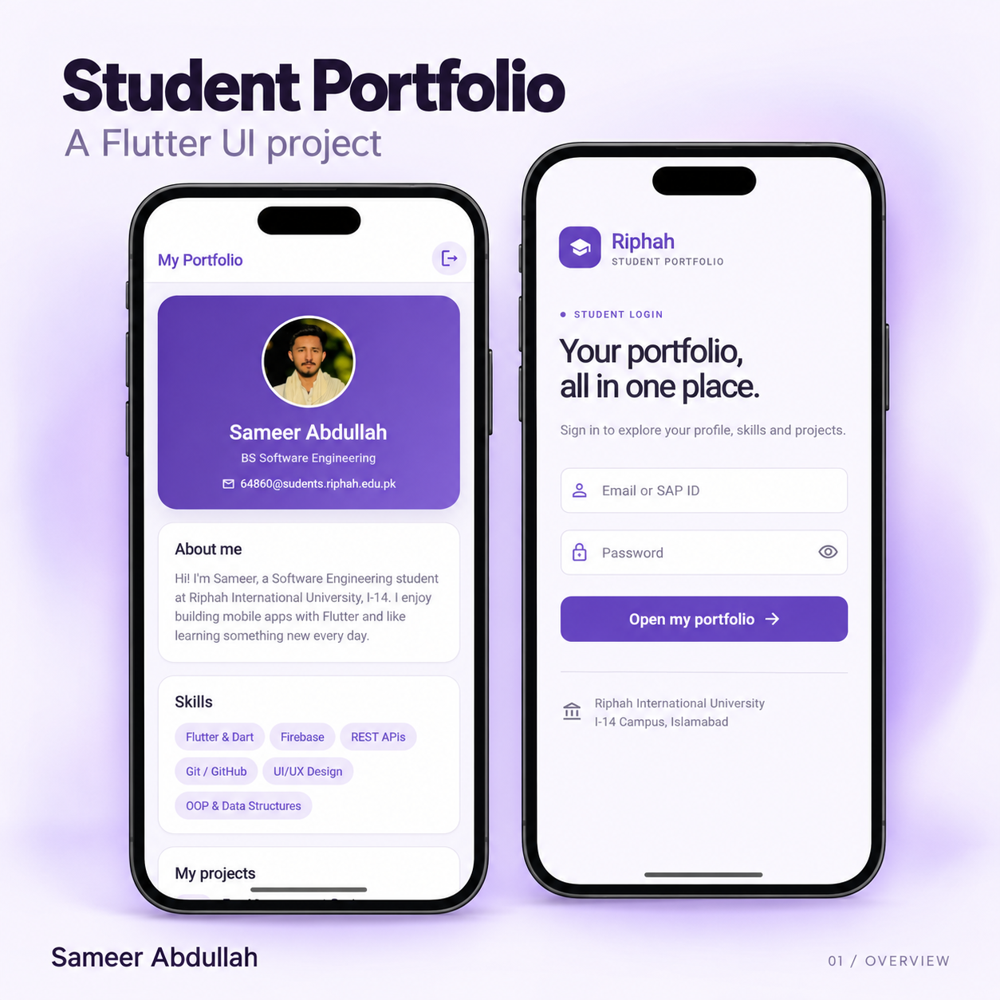

# MAD - Student Portfolio

A student portfolio app by **Sameer Abdullah**, built with Flutter, Dart and Material 3. The interface uses a consistent purple and lavender theme across the login screen, profile, projects and contact details.

## Features

- Email or numeric SAP ID sign-in interface with form validation and password visibility toggle.
- Personal profile, photo and introduction.
- Skills and project showcases.
- Project entries for Fee Management System, Attendance Management System and Inventory Management System.
- Contact details with copy-to-clipboard actions.
- Sign-out confirmation dialog.
- Scrollable layouts and a phone-frame preview on larger web screens.

The sign-in flow is a local UI demonstration. It accepts a valid email or numeric SAP ID and any password of at least four characters; it does not connect to a university account or authentication backend. The management systems are portfolio entries, rather than functional modules in this app.

## Preview



The showcase images are presentation mockups based on the app screenshots. The second image and ready-to-use LinkedIn caption are in [output/linkedin](output/linkedin/).

## Run locally

Install Flutter with a Dart SDK compatible with `^3.13.1`, then run:

```sh
git clone https://github.com/itx-Samii/MAD.git
cd MAD
flutter pub get
flutter run -d chrome
```

For another connected device, run `flutter devices`, then `flutter run -d <device-id>`.

## Check the project

```sh
flutter analyze
flutter test
```

## Project structure

| Path | Contents |
| --- | --- |
| `lib/main.dart` | App theme, login flow and portfolio UI |
| `image/` | Profile image and image assets |
| `test/widget_test.dart` | Login validation, navigation and sign-out tests |
| `output/linkedin/` | Showcase images, caption and image-generation prompts |
| `android/`, `ios/`, `web/`, `windows/`, `macos/`, `linux/` | Flutter platform projects |

Build output, SDK caches, IDE settings and local configuration are excluded from version control.